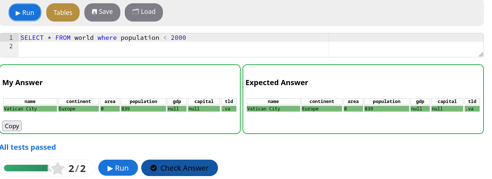

H5P SQL Question
=====================

An interactive SQL question content type for H5P, 
allowing educators to create SQL exercises that 
run and validate queries directly in the browser.

This content type is actively used in teaching, 
tested in real courses, and suitable for self‑study 
and classroom settings.

## What This Does

This H5P content type:

* Provides an interactive SQL environment in H5P.
* Allows authors to define SQL problems and expected results.
* Executes queries in the student’s browser using a JavaScript SQL engine (sql.js).
* Compares student query results against expected table results.
* Works without server‑side execution, making it safe and portable across hosts.

## Key Features

* Interactive SQL editor inside H5P
* In‑browser execution with sql.js (no server required)
* Table result comparison for automatic validation
* Integration with common H5P workflows in LMS like Moodle
* Designed for educators and learners in database courses

## Grading by solution (for teachers)

With the grading method **By Solution**, the result table of the learner's query
is compared with the result table of the solution query.

* **Result comparison** – choose whether the row order matters (for
  `ORDER BY` tasks), whether column names/aliases must match or only the values
  count, whether letter case is ignored and how large a numeric tolerance is.
  The defaults ignore the row order and require identical column names.
* **Query requirements** – require or forbid SQL keywords (for example `JOIN`,
  `GROUP BY`, `LIMIT`), forbid subqueries or `SELECT *`. They apply to every
  test case. Comments and string literals are ignored.
* **Test cases (data variants)** – each test case runs the solution query and the
  learner query on the database plus its *setup SQL* (for example additional
  `INSERT` statements). This detects answers that only work for the visible
  data. The default database is always tested first. A test case can have a
  name, a learning goal, a hint after failure, points and can be hidden.
* **Partial credit** – award each passed test case its points instead of
  all-or-nothing grading.
* **Hint cascade, worked example and due date** work like in PythonQuestion.

The **task assistant** at the top of the editor offers three editable templates
and a task check (missing database or solution, conflicting keywords, a
solution that violates its own requirements, test cases without setup SQL, ...).
The solution query is part of the content and can be read in the page source.
